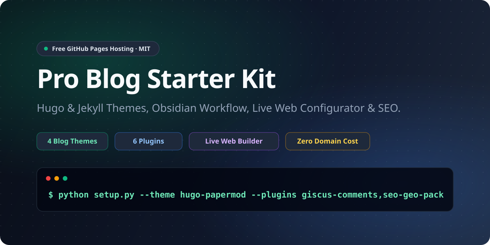
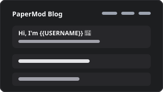
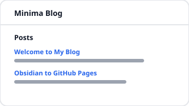
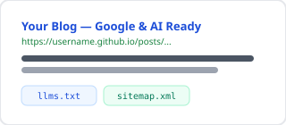

<div align="center">



# ✍️ Pro Blog Starter Kit

[](https://github.com/cmduyeen/pro-blog-starter-kit/actions/workflows/validate-extensions.yml)
[](https://www.python.org/downloads/)
[](LICENSE)
[](https://github.com/cmduyeen/pro-blog-starter-kit/generate)
[](https://cmduyeen.github.io/pro-blog-starter-kit/)

**Launch a fast, SEO-ready personal blog on GitHub Pages in 60 seconds—free hosting, no domain needed, Markdown-first.**

[🚀 Launch Web Configurator](https://cmduyeen.github.io/pro-blog-starter-kit/) · [⚡ Use This Template](https://github.com/cmduyeen/pro-blog-starter-kit/generate) · [Themes (4)](#-1-pick-a-blog-theme-themes) · [Plugins (6)](#-2-snap-in-blog-plugins-plugins) · [Pair with Profile Kit](https://github.com/cmduyeen/pro-github-starter-kit)

</div>

---

## ⚡ Launch Your Blog in 60 Seconds

1. **Create your blog repo:** Click **[Use This Template](https://github.com/cmduyeen/pro-blog-starter-kit/generate)** and name it `<your-username>.github.io` (Public).
2. **Configure visually:** Open the **[Web Configurator](https://cmduyeen.github.io/pro-blog-starter-kit/)**, pick Hugo or Jekyll, toggle plugins, and download your config + `deploy-blog.yml`.
3. **Publish:** Enable **Settings → Pages → Source: GitHub Actions** and push your first Markdown post!

<details>
<summary><b>🛠️ Prefer Terminal CLI? (1 zero-dependency Python command)</b></summary>

```bash
# Interactive wizard
python setup.py

# Or one-line CLI
python setup.py --username <your-username> \
  --title "My Digital Garden" \
  --theme hugo-papermod \
  --plugins giscus-comments,seo-geo-pack,rss-profile-sync
```

</details>

---

## 🧩 Modular Blog Themes & Plugins

Built with the same **Obsidian-inspired architecture** as [pro-github-starter-kit](https://github.com/cmduyeen/pro-github-starter-kit).

### 1. Pick a Blog Theme (`themes/`)

<!-- THEMES-TABLE:START -->
<table>
  <tr>
    <td align="center" valign="top" width="50%">
      <a href="themes/hugo-minimal-notes/config.template"></a><br/>
      <b><code>hugo-minimal-notes</code></b> (HUGO) · <a href="themes/hugo-minimal-notes/config.template">Preview</a> · <a href="themes/hugo-minimal-notes/config.template">Config</a><br/>
      <sub>Digital garden & Zettelkasten-friendly Hugo setup optimized for long-form writing. <i>(by @cmduyeen)</i></sub>
    </td>
    <td align="center" valign="top" width="50%">
      <a href="themes/hugo-papermod/config.template"></a><br/>
      <b><code>hugo-papermod</code></b> (HUGO) · <a href="themes/hugo-papermod/config.template">Preview</a> · <a href="themes/hugo-papermod/config.template">Config</a><br/>
      <sub>Ultra-fast minimalist Hugo blog with PaperMod, built-in search, dark mode, and RSS. <i>(by @cmduyeen)</i></sub>
    </td>
  </tr>
  <tr>
    <td align="center" valign="top" width="50%">
      <a href="themes/jekyll-chirpy/config.template"></a><br/>
      <b><code>jekyll-chirpy</code></b> (JEKYLL) · <a href="themes/jekyll-chirpy/config.template">Preview</a> · <a href="themes/jekyll-chirpy/config.template">Config</a><br/>
      <sub>Feature-rich technical blog theme with sidebar TOC, dark mode, and categories. <i>(by @cmduyeen)</i></sub>
    </td>
    <td align="center" valign="top" width="50%">
      <a href="themes/jekyll-minima/config.template"></a><br/>
      <b><code>jekyll-minima</code></b> (JEKYLL) · <a href="themes/jekyll-minima/config.template">Preview</a> · <a href="themes/jekyll-minima/config.template">Config</a><br/>
      <sub>Zero-config official GitHub Pages theme—no extra dependencies required. <i>(by @cmduyeen)</i></sub>
    </td>
  </tr>
</table>
<!-- THEMES-TABLE:END -->

### 2. Snap in Blog Plugins (`plugins/`)

<!-- PLUGINS-TABLE:START -->
<table>
  <tr>
    <td align="center" valign="top" width="33%">
      <a href="plugins/giscus-comments/snippet.md"></a><br/>
      <b><code>giscus-comments</code></b> · <a href="plugins/giscus-comments/snippet.md">Guide</a> · <a href="plugins/giscus-comments/snippet.md">Snippet</a><br/>
      <sub>Free, ad-free blog comments powered by GitHub Discussions. <i>(by @cmduyeen)</i></sub>
    </td>
    <td align="center" valign="top" width="33%">
      <a href="plugins/goatcounter-analytics/snippet.md"></a><br/>
      <b><code>goatcounter-analytics</code></b> · <a href="plugins/goatcounter-analytics/snippet.md">Guide</a> · <a href="plugins/goatcounter-analytics/snippet.md">Snippet</a><br/>
      <sub>Free, privacy-friendly pageview analytics with zero cookies or GDPR banners. <i>(by @cmduyeen)</i></sub>
    </td>
    <td align="center" valign="top" width="33%">
      <a href="plugins/math-diagrams/snippet.md"></a><br/>
      <b><code>math-diagrams</code></b> · <a href="plugins/math-diagrams/snippet.md">Guide</a> · <a href="plugins/math-diagrams/snippet.md">Snippet</a><br/>
      <sub>Enables LaTeX math (KaTeX) and Mermaid flowcharts inside Markdown posts. <i>(by @cmduyeen)</i></sub>
    </td>
  </tr>
  <tr>
    <td align="center" valign="top" width="33%">
      <a href="plugins/obsidian-template/snippet.md"></a><br/>
      <b><code>obsidian-template</code></b> · <a href="plugins/obsidian-template/snippet.md">Guide</a> · <a href="plugins/obsidian-template/snippet.md">Snippet</a><br/>
      <sub>Adds an Obsidian-ready frontmatter archetype for seamless Markdown publishing. <i>(by @cmduyeen)</i></sub>
    </td>
    <td align="center" valign="top" width="33%">
      <a href="plugins/rss-profile-sync/snippet.md"></a><br/>
      <b><code>rss-profile-sync</code></b> · <a href="plugins/rss-profile-sync/snippet.md">Guide</a> · <a href="plugins/rss-profile-sync/snippet.md">Snippet</a><br/>
      <sub>Outputs clean RSS feeds ready to auto-sync into your GitHub Profile README. <i>(by @cmduyeen)</i></sub>
    </td>
    <td align="center" valign="top" width="33%">
      <a href="plugins/seo-geo-pack/snippet.md"></a><br/>
      <b><code>seo-geo-pack</code></b> · <a href="plugins/seo-geo-pack/snippet.md">Guide</a> · <a href="plugins/seo-geo-pack/snippet.md">Snippet</a><br/>
      <sub>Adds robots.txt, llms.txt, and clean RSS/Sitemap defaults for Google & AI Search. <i>(by @cmduyeen)</i></sub>
    </td>
  </tr>
</table>
<!-- PLUGINS-TABLE:END -->

---

## 🤝 Build Together & FAQ

Anyone can contribute a new Hugo/Jekyll theme or blog plugin via Pull Request—see **[CONTRIBUTING.md](CONTRIBUTING.md)**.

<details>
<summary><b>❓ FAQ — Quick Answers</b></summary>

1. **Do I need to buy a custom domain?**  
   No. GitHub Pages gives you `https://<your-username>.github.io/` for free with HTTPS included.
2. **How do I show my latest blog posts on my GitHub Profile?**  
   Enable `rss-profile-sync` here, and enable the `blog-rss` plugin in [pro-github-starter-kit](https://github.com/cmduyeen/pro-github-starter-kit).
3. **Does GitHub Pages cost anything for public blogs?**  
   No. Public repositories get free GitHub Pages hosting and unlimited standard GitHub Actions minutes.

</details>

---

<div align="center">

[MIT License](LICENSE) · Crafted by [cmduyeen](https://github.com/cmduyeen) · **Star ⭐ this repo if it helped you launch your blog!**

</div>
